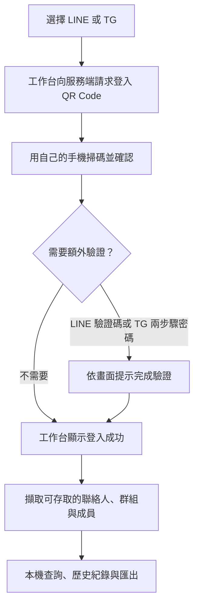

# 通訊資料工作台

這裡只提供版本公告、下載連結與使用說明，不包含程式原始碼、應用程式憑證或使用者資料。

## Windows V1.0.2（修訂 2）

- 修正 LINE 掃碼及手機驗證通過後，讀取帳號資料失敗的相容性問題。
- 新增背景更新通知與「檢查更新」。有新版時可按「前往下載」，不會自動安裝。
- 1.0.1 與早期 1.0.2 沒有更新提示，請先手動更新一次。
- 請完整下載 ZIP 並解壓縮，保留 `_internal`，不要只取出 EXE。

[下載 Windows 完整版](https://drive.google.com/file/d/1lgGPuFMCJztu1GC3FVa6cBnVghb9gA8-/view)

## 登入流程

LINE：按「開啟 LINE」，使用手機 LINE 掃碼，依提示在手機完成驗證。工作台顯示登入成功後，再按「擷取 MID」。本版修正的是手機驗證後讀取帳號資料的連線相容性；手機仍需本人確認。

TG：按「TG 登入」，在手機 Telegram 的「設定 → 裝置 → 連結桌面裝置」掃碼。有啟用兩步驟驗證時，依提示輸入密碼。登入完成後可擷取帳號可存取的資料。

TG 的 `api_id` / `api_hash` 是應用程式身分；掃碼確認的是使用者帳號。共用應用程式身分不會讓別人的登入出現在開發者的帳號裡。誰用手機確認登入，新增裝置就屬於誰的帳號。QR Code 是短效登入請求，不是固定帳號密碼。

LINE 直接登入使用非官方元件，仍受服務相容性影響。LINE MID 不可替代 Messaging API User ID；群組成員是否完整取決於帳號權限與服務回傳。工具不包含聊天訊息擷取。

## 圖文使用說明

含各功能截圖的 PDF 正在整理，完成文字、排版與圖片檢查後另行發布。
